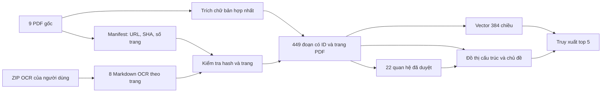

# Xử lý OCR và đồ thị quan hệ văn bản HaUI

Cập nhật 28/09/2026. Tài liệu này mô tả chỉ mục hiện tại của dự án và cách kiểm tra chứng cứ khi viết báo cáo. Phạm vi là **9 PDF đã tải**, gồm 1 PDF có lớp chữ và 8 PDF ảnh quét có bản OCR Markdown do người dùng cung cấp. Hiệu lực pháp lý hiện hành của các văn bản chưa được xác minh.

## Luồng dữ liệu



`src/ocr_corpus.py` đọc mốc `## Trang N`, yêu cầu trang tăng liên tục từ 1 và bằng số trang PDF trong manifest. SHA-256 của PDF và Markdown OCR phải khớp manifest. Mỗi trang được chia thành đoạn tối đa 1.000 ký tự tại ranh giới từ; không ghép chứng cứ xuyên trang. Mỗi đoạn OCR mang `page_start`, `source_url`, `source_sha256`, `ocr_sha256` và `ocr_review_status=page_matched_unreviewed`. Kết quả gồm **313 đoạn OCR**. Bản hợp nhất lấy chữ bằng PyMuPDF, chia theo Điều/khoản và thêm đoạn lời mở đầu: **136 đoạn**. Tổng cộng **449 đoạn** trong `data/processed/articles.jsonl`.

Hash và số trang chứng minh rằng chỉ mục được tạo từ đúng tệp đã ghi nhận. Chúng **không** chứng minh từng chữ OCR chính xác. Các lỗi dấu, số quyết định, ký hiệu và bảng vẫn có thể đi vào tìm kiếm. Hiện không có quy trình hiệu đính toàn bộ; khi dùng một kết quả cho nhận định pháp lý phải mở trang PDF qua URL nguồn và đọc lại.

## Mô hình đồ thị

`src/legal_graph.py` tạo `MultiDiGraph` có hướng. Bản chỉ mục hiện có **480 nút, 1.872 cạnh**:

| Nút | Ý nghĩa |
|---|---|
| `Document` | 9 văn bản có toàn văn trong corpus; 13 văn bản chỉ được nhắc tới là nút tham chiếu `corpus_present=false` |
| `Article` | 449 đoạn văn bản có ID và trang, kể cả đoạn OCR chưa tách Điều/khoản chắc chắn |
| `Topic`, `Audience` | Chủ đề và đối tượng tìm kiếm rút từ từ khóa trong đoạn |

| Cạnh | Chiều và cách dùng |
|---|---|
| `CONTAINS` | Văn bản → đoạn; nối nguồn với chứng cứ |
| `NEXT` | Đoạn → đoạn kế tiếp trong cùng văn bản; hỗ trợ ngữ cảnh |
| `ABOUT`, `APPLIES_TO` | Đoạn → chủ đề/đối tượng; cạnh truy xuất theo từ khóa, không phải phát biểu pháp lý |
| `AMENDS`, `REPLACES`, `SUPPLEMENTS`, `CONSOLIDATES`, `CITES` | Văn bản → văn bản; cạnh có trang và câu dẫn được kiểm tra |

**22 cạnh pháp lý** được khai báo trong `data/relations_reviewed.json`. Mỗi cạnh có `evidence_document`, `evidence_page`, `evidence_text`. Khi dựng chỉ mục, `reviewed_relations()` yêu cầu câu dẫn xuất hiện trong đúng trang Markdown OCR và trong một đoạn đã lập chỉ mục ở trang đó. Nếu không khớp, quá trình dừng. File `data/processed/legal_relations.json` ghi thêm ID đoạn và URL PDF kèm `#page=N`. Riêng bản hợp nhất dùng Markdown trong ZIP làm bản đối chiếu câu dẫn, còn nội dung trả lời lấy từ lớp chữ PDF. Nút tham chiếu chưa có toàn văn không được đưa vào phần chứng cứ trả lời.

Ví dụ quan hệ đã ghi nhận:

| Nguồn → đích | Loại | Trang chứng cứ | Cách đọc |
|---|---|---:|---|
| QĐ 721/2024 → QĐ 254/2023, QĐ 1432/2023 | `REPLACES` | 1 | QĐ 721 ghi thay thế hai quyết định này; [mở PDF HaUI](https://cps.haui.edu.vn/media/quyet-dinh-721-ngay-03-06-2024-ve-viec-ban-hanh-quy-dinh-to-chuc-dgkqht-cua-nguoi-hoc-truong-dhcn-hn%20%285%29.pdf#page=1) |
| QĐ 663/2019 → QĐ 787/2018 | `AMENDS` | 1 | QĐ 663 ghi sửa đổi, bổ sung quy chế theo QĐ 787; [mở PDF HaUI](https://dttc.haui.edu.vn/media/2/uftai-ve-tai-day2712.pdf#page=1) |
| Quy định khóa luận QĐ 1077/2023 → TT 08/2021 | `CITES` | 1 | Dẫn thông tư làm căn cứ, không phải sửa thông tư |
| Bản hợp nhất 2023 → QĐ 744/2021 và QĐ 666/2023 | `CONSOLIDATES` | 1 | Bản hợp nhất chứa quy chế gốc và phần sửa đổi |

Các cạnh nói trên thể hiện điều được ghi trong tài liệu nguồn. `REPLACES` không tự xác nhận văn bản nguồn vẫn có hiệu lực tại ngày tra cứu. `CITES` chỉ là quan hệ viện dẫn. Một vài câu dẫn giữ nguyên lỗi OCR, ví dụ dấu gạch dư ở số QĐ 1432; metadata ghi chú lỗi này và URL PDF cho phép đối chiếu. Quét tham chiếu còn thấy các số hiệu 945/QĐ-TTg, 4811/QĐ-BCT, 862/QĐ-ĐHCN, 366/QĐ-ĐHCN, 1224/QĐ-ĐHCN và 1202/QĐ-ĐHCN. Chúng chưa được lập cạnh vì chưa rà toàn văn, vai trò và số hiệu từ PDF gốc; do đó **22 cạnh không phải danh sách quan hệ đầy đủ của 9 PDF**.

## GraphRAG truy xuất như thế nào

RAG vector mã hóa câu hỏi và lấy 5 đoạn có cosine cao nhất. GraphRAG lấy 3 hạt giống từ TF-IDF ký tự và 2 hạt giống vector, mở rộng sang đoạn kề, chủ đề và tối đa 2 bước qua cạnh văn bản. Khi câu hỏi nêu rõ số hiệu/tên văn bản và loại quan hệ, nó bổ sung đoạn chứng cứ của cạnh tương ứng. Các ứng viên được xếp bằng `0,55 × TF-IDF + 0,45 × cosine`; đoạn chứng cứ của quan hệ được hỏi nhận thêm 0,7 điểm. Cả hai phương pháp dùng `top_k=5` và trần 6.500 ký tự đưa vào Gemini.

Vì GraphRAG cũng dùng vector và TF-IDF, phép so sánh hiện tại đo **toàn bộ chiến lược truy xuất lai có đồ thị** so với vector thuần, chưa tách riêng đóng góp của từng thành phần. Trace của API hiển thị hạt giống, văn bản/chủ đề khớp, cạnh đi qua, ID chứng cứ và URL.

## Kết quả và cách tái lập

| Tập câu hỏi | RAG vector Recall@5 | GraphRAG Recall@5 | Cách diễn giải |
|---|---:|---:|---|
| 25 câu có gold trong bộ 30 câu cũ | 0,70 | 0,74 | Gold thuộc bản hợp nhất; câu hỏi có thể mơ hồ sau khi thêm tài liệu |
| 8 câu quan hệ nhiều văn bản | 0,1875 | 1,0 | Kiểm tra truy xuất cạnh vừa thiết kế; cùng tác giả soạn câu hỏi/gold nên có thiên lệch |

Bộ 8 câu: RAG tìm đủ mọi gold ID ở 0/8 câu, GraphRAG ở 8/8. Đây là phép đo **truy xuất**, chưa đo độ đúng của câu trả lời Gemini trên corpus mới. Kết quả thô: `evaluation/runs/latest.json`, `evaluation/runs/multidoc_ocr_retrieval.json`; báo cáo: `report/report.md`.

```bash
python3 -m src.sources
python3 -m src.project prepare
python3 -m src.project evaluate --retrieve-only
python3 -m evaluation.evaluate_multidoc
```

Cần giữ `data/ocr/*.md` cạnh `data/raw/*.pdf` trước khi chạy lại. Sau khi cập nhật OCR, chạy lại `src.sources` để ghi hash mới, rà từng thay đổi, rồi dựng chỉ mục và đánh giá lại. Chưa có bảo đảm rằng 22 cạnh là mọi quan hệ của toàn bộ văn bản HaUI; chỉ những cạnh có câu dẫn trong tập thu thập mới được đưa vào đồ thị.
